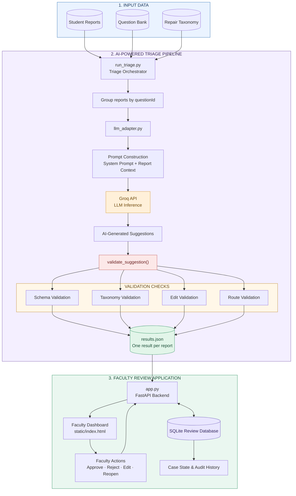

# Acadza Report → Fix

**An LLM-assisted question-integrity triage system with a faculty review
workspace.**

Acadza Report → Fix helps faculty review student-reported issues in
JEE/NEET question content. It groups duplicate reports by question, uses
an LLM to assess the reported issue and propose a narrowly scoped
correction, validates the suggestion against project rules, and presents
the result for faculty review.

**Live demo:** https://acadguard.onrender.com/\
**Repository:** https://github.com/DurgeshRajput11/AcadGuard

> **Prototype scope:** This is a faculty-supervised demo. Approve,
> Reject, Edit, and Reopen actions update the prototype's SQLite review
> state and audit log. They do not modify Acadza's production question
> bank or send notifications to students.

------------------------------------------------------------------------

## Table of contents

-   [Problem](#problem)
-   [What the system does](#what-the-system-does)
-   [Architecture and data flow](#architecture-and-data-flow)
-   [Technology stack](#technology-stack)
-   [Project structure](#project-structure)
-   [Run locally](#run-locally)
-   [Run LLM triage](#run-llm-triage)
-   [Environment configuration](#environment-configuration)
-   [Faculty workspace](#faculty-workspace)
-   [API endpoints](#api-endpoints)
-   [Safety and validation](#safety-and-validation)
-   [Deployment](#deployment)
-   [Limitations](#limitations)
-   [Troubleshooting](#troubleshooting)

## Problem

Students can report incorrect answer keys, incomplete question
statements, broken options, solution errors, formatting problems, and
other content issues. These reports may overlap: several students can
report the same underlying question.

A useful review workflow needs to do more than classify a comment. It
should:

1.  Combine reports that refer to the same question.
2.  Check the report against the supplied question, answer, solution,
    and repair taxonomy.
3.  Explain the evidence behind a proposed decision.
4.  Avoid guessing when the evidence is incomplete.
5.  Keep a faculty member in control of consequential changes.
6.  Preserve a record of review actions.

## What the system does

### LLM-assisted triage

-   Processes reports grouped by `questionId`, reducing duplicate model
    work.
-   Sends the question, its student reports, and the allowed repair
    taxonomy to the Groq-hosted LLM.
-   Produces a structured decision containing:
    -   `verdict`
    -   `repair`
    -   `edit`
    -   `route`
    -   `confidence`
    -   `evidence`
    -   `student_reply`
-   Fans the question-level decision back out to the corresponding
    report records.
-   Saves results as JSON so the dashboard can load the completed triage
    without making a model request on every page refresh.

The configured default model in the adapter is `openai/gpt-oss-120b`
through the Groq API. The submitted `results.json` is a precomputed, reviewed
benchmark output; opening the dashboard does not make a model request.

### Faculty review workspace

The web dashboard provides:

-   **Review Queue:** question-level cases, search, and route filters.
-   **Case details:** subject, chapter, question metadata, student
    comments, and AI assessment.
-   **Question preview:** supplied HTML/MathML rendered in a sandboxed
    iframe.
-   **Evidence and confidence:** the model's rationale and confidence
    estimate.
-   **Before/after preview:** a focused view of the proposed
    replacement.
-   **Faculty actions:** Approve, Reject, Edit, and Reopen.
-   **Student reply preview:** a draft response associated with the
    assessment.
-   **Audit History:** recorded faculty actions, notes, actor, and
    timestamp.
-   **Question Bank view:** searchable read-only view of the supplied
    question data.
-   **Triage taxonomy:** the repair and routing rules used by the
    application.

### Current benchmark snapshot

The included live triage output contains **44 report decisions across 39
unique questions**. The exact route counts can change if the triage
output or faculty review state changes.

## Architecture and data flow



**Important:** LLM triage is a batch-processing step. The dashboard
reads the generated `results.json` file; opening or refreshing the
dashboard does not, by itself, call Groq again. Run the triage command
when you want to generate a new set of model decisions.

## Technology stack

-   **Python** --- triage pipeline and backend
-   **FastAPI** --- API and dashboard backend
-   **Groq API** --- hosted LLM inference
-   **OpenAI-compatible chat completions interface** --- model request
    format used by the adapter
-   **Pydantic** --- structured request validation
-   **SQLite** --- demo review state and audit history
-   **HTML, CSS, JavaScript** --- faculty dashboard
-   **JSON** --- benchmark data, taxonomy, and triage output
-   **Render** --- web deployment

## Project structure

``` text
AcadGuard/
├── app.py                         # FastAPI app, API routes, review state and audit log
├── llm_adapter.py                 # Groq integration and suggestion validation
├── run_triage.py                  # Grouped live triage runner
├── results.json              # Generated triage decisions loaded by the dashboard
├── requirements.txt               # Python dependencies
├── render.yaml                    # Render deployment configuration
├── data/
│   ├── questions.json             # Supplied question bank
│   ├── reports.json               # Student-submitted reports
│   └── taxonomy.json              # Allowed verdicts, repairs and fields
├── prompts/
│   ├── triage_system.txt          # Triage instructions and safety rules
│   └── triage_user_template.txt   # Question/report input template
└── static/
    └── index.html                 # Faculty workspace UI
```

The triage runner may also create a checkpoint JSON file while
processing. It is an execution artifact used for resuming a run, not the
final dashboard dataset.

## Run locally

### 1. Clone the repository

``` bash
git clone https://github.com/DurgeshRajput11/AcadGuard.git
cd AcadGuard
```

### 2. Create and activate a virtual environment

**Windows PowerShell**

``` powershell
python -m venv .venv
.\.venv\Scripts\Activate.ps1
```

**macOS / Linux**

``` bash
python3 -m venv .venv
source .venv/bin/activate
```

### 3. Install dependencies

``` bash
python -m pip install --upgrade pip
pip install -r requirements.txt
```

### 4. Configure the Groq API key

Create an API key in the [Groq Console](https://console.groq.com/keys).

Set it as an environment variable before running live triage.

**Windows PowerShell**

``` powershell
$env:GROQ_API_KEY="your_groq_api_key"
```

**macOS / Linux**

``` bash
export GROQ_API_KEY="your_groq_api_key"
```

Do not commit API keys, `.env` files, or other secrets to Git.

### 5. Start the dashboard

Make sure `results.json` exists in the project root. Then run:

``` bash
uvicorn app:app --reload
```

Open:

-   Dashboard: http://127.0.0.1:8000/
-   Health check: http://127.0.0.1:8000/health

The application uses `results.json` by default. To load a different
results file, set `RESULTS_FILE` before starting the server.

**PowerShell example:**

``` powershell
$env:RESULTS_FILE="results.json"
uvicorn app:app --reload
```

## Run LLM triage

The triage runner sends one grouped request per unique question and
writes report-level decisions to the output JSON.

``` bash
python run_triage.py --live --output results.json
```

Useful behavior:

-   `--live` enables model-backed triage.
-   `--output` selects the output JSON path.
-   The runner supports checkpointing/resuming so an interrupted run
    does not necessarily require starting from the beginning.
-   `--restart` starts a fresh run rather than resuming an existing
    checkpoint.

After the run completes, restart the dashboard process if it is already
running so the application reloads the newly generated results file.

**Do not run live triage just to view the dashboard.** The dashboard
uses the saved JSON output and does not need a Groq request for each
page load.

## Environment configuration

  -----------------------------------------------------------------------
  Variable                            Purpose
  ----------------------------------- -----------------------------------
  `GROQ_API_KEY`                      API key used by the Groq adapter
                                      for live triage

  `RESULTS_FILE`                      Results JSON file loaded by
                                      FastAPI; defaults to
                                      `results.json`
  -----------------------------------------------------------------------

Keep secrets in your local environment or the hosting provider's
environment-variable settings. Never put a real API key in source code,
README examples, screenshots, or Git commits.

## Faculty workspace

The dashboard groups the 44 report records into question-level cases so
faculty can review duplicate reports together.

Typical review flow:

1.  Open a case from the Review Queue.
2.  Read the student comments and inspect the question and solution
    previews.
3.  Review the AI verdict, repair category, evidence, confidence, and
    proposed edit.
4.  Compare the before/after preview.
5.  Add an optional faculty note.
6.  Approve, Reject, Edit, or Reopen the case.
7.  Confirm the action appears in Audit History.

Faculty actions are stored in the local SQLite database
(`review_audit.db`). The UI's approval action records a review decision;
it does not publish the proposed correction to the real question bank.

## API endpoints

  ----------------------------------------------------------------------------
  Method                  Endpoint                     Purpose
  ----------------------- ---------------------------- -----------------------
  `GET`                   `/`                          Serves the faculty
                                                       dashboard

  `GET`                   `/health`                    Reports
                                                       application/data load
                                                       status

  `GET`                   `/api/summary`               Returns report,
                                                       question, route, and
                                                       resolution counts

  `GET`                   `/api/cases`                 Lists grouped review
                                                       cases; supports search,
                                                       route, and status
                                                       filters

  `POST`                  `/api/action`                Records approve,
                                                       reject, edit, or reopen
                                                       actions

  `GET`                   `/api/audit`                 Returns the audit
                                                       history

  `GET`                   `/api/audit/{question_id}`   Returns audit entries
                                                       for one question

  `GET`                   `/api/question-bank`         Returns searchable
                                                       question-bank records

  `GET`                   `/api/taxonomy`              Returns the allowed
                                                       triage taxonomy
  ----------------------------------------------------------------------------

FastAPI's interactive API documentation is available at `/docs` while
the server is running.

## Safety and validation

The project is designed to fail safely rather than treating every
student claim as proof.

-   Student comments and question content are treated as untrusted
    input, not as instructions to the model.
-   The model is instructed to use only the supplied verdict and repair
    taxonomy.
-   Proposed edits are expected to be narrow and tied to exact source
    text or a specific answer value.
-   The adapter validates the model response before it is accepted as a
    triage result.
-   Unknown taxonomy values, invalid structures, and out-of-scope edits
    are rejected or routed for human review.
-   Answer-key changes require especially careful verification and
    should remain under faculty control.
-   The dashboard displays supplied question HTML/MathML in sandboxed
    iframes with scripts disabled.
-   Faculty actions are written to the demo audit database.

A model confidence value is an estimate produced by the triage process;
it is not a guarantee that a decision is correct. Faculty should
independently verify high-impact corrections, especially answer keys,
missing question data, and full solution changes.

## Deployment

The repository includes a Render configuration (`render.yaml`) for
deploying the FastAPI service.

For a deployed service:

1.  Connect the GitHub repository to Render.
2.  Configure `GROQ_API_KEY` in the service's **Environment** settings
    if live triage will be run in that environment.
3.  Ensure the deployed service has the required data files and
    `results.json`.
4.  Deploy and check the service's `/health` endpoint.
5.  Open the dashboard and verify the review queue and case details.

The dashboard can serve an already generated `results.json` without
making a Groq call on every request. If you want to regenerate triage in
production, run the triage job in an environment where the Groq key and
input data are available, then deploy or otherwise provide the resulting
JSON file.

### SQLite persistence note

SQLite is used for prototype review state and audit history. On hosting
platforms that use ephemeral filesystems, local SQLite data can be lost
when an instance is replaced or restarted. For durable multi-user
production use, move audit and case-state storage to a managed database
such as PostgreSQL and configure persistent storage and access control.

## Limitations

-   This is a benchmark/demo workflow, not a production integration with
    Acadza's live question bank.
-   It does not send real student notifications.
-   Faculty actions update demo review state and the audit log only.
-   The dashboard reads precomputed triage JSON; it is not a live chat
    interface and does not invoke the LLM on every page load.
-   SQLite persistence depends on the hosting filesystem.
-   Model output can be wrong. Human review remains necessary for
    ambiguous or high-impact cases.

## Troubleshooting

### `GROQ_API_KEY` is missing

Set the environment variable in the same terminal/session used to run
`run_triage.py`, or configure it in the hosting provider's environment
settings.

### `results.json` not found

Run the triage pipeline to generate it, or set `RESULTS_FILE` to the
name of an existing results JSON file in the project root.

### Dashboard starts but shows no cases

Check that the data files exist under `data/`, that the results JSON is
valid, and that report IDs in the results match the supplied reports.
Then inspect `/health`.

### Dashboard changes do not appear after regenerating results

Stop and restart the FastAPI process so the app reloads the results JSON
at startup.

### Live triage is interrupted

Use the runner's checkpoint/resume behavior. Use `--restart` only when
you intentionally want to discard the prior checkpoint and begin a fresh
run.

------------------------------------------------------------------------

## Author

**Durgesh Singh Gour**\
B.Tech, Information Technology --- IIIT Una

------------------------------------------------------------------------

*Built as an LLM-assisted academic question-integrity and faculty-review
prototype.*
